# Lab 01 — External Collaboration Lockdown & Guest Lifecycle

**Completed:** July 2026  
**Environment:** Microsoft Entra ID lab tenant with a P2 trial  
**SC-300 area:** Identity management / External identities

## Overview

I configured external collaboration controls in a personal Entra ID tenant and tested guest invitations and account lifecycle actions. I compared successful and blocked operations, recorded unexpected portal behavior, and documented what the evidence does and does not establish.

This is a **simulated business scenario**, completed for learning. The policy requirements below do not represent a real organization's security mandate.

## Scenario and requirements

A simulated organization wants to reduce uncontrolled guest access:

1. Restrict guests to properties and memberships of their own directory objects.
2. Allow designated staff with an appropriate role to invite guests; prevent ordinary members from doing so.
3. Block invitations to `gmail.com`.
4. Allow guests to leave the organization themselves.

## Configuration

In **External Identities → External collaboration settings**, I configured:

| Setting | Lab configuration |
| --- | --- |
| Guest user access restrictions | Most restrictive option: properties and memberships of their own directory objects |
| Guest invite restrictions | Only users assigned to specific admin roles can invite |
| Self-service sign-up via user flows | Disabled |
| External user leave settings | Guests allowed to leave the organization |
| Collaboration restrictions | Deny-list mode; screenshot records the entered value `*gmail.com` |

I assigned the **Guest Inviter** role to a test member account for the delegated invitation test. The ordinary-member test used an account without an invitation-capable role.

**Domain-entry evidence note:** The requirement targeted `gmail.com`, while the captured configuration shows `*gmail.com`. The blocked invitation test demonstrates the observed result for that test address; it does not establish how the pattern behaves for other domains or subdomains.

## Test sequence

1. Attempt an invitation to the blocked domain.
2. Attempt an invitation as an ordinary member without an invitation-capable role.
3. Invite an external Entra account using the delegated Guest Inviter account.
4. Redeem the invitation and inspect the guest's state.
5. Disable the guest, retest sign-in, and re-enable the account.
6. Soft-delete the guest, locate it in Deleted users, and restore it.

## Results and evidence

The screenshots record the lab observations below. Personal account identifiers have been redacted; test outcomes and relevant controls remain visible.

| # | Evidence | Observation |
| --- | --- | --- |
| 01 | [External collaboration settings](images/01-external-collab-settings-final.png) | Records the configured collaboration controls. Configuration alone does not establish every control's runtime behavior. |
| 02 | [Blocked-domain invitation](images/02-guest-invite-blocked-denied-domain.png) | The invitation fails with a domain-collaboration policy error. |
| 03 | [Ordinary-member invitation](images/03-member-invite-blocked.png) | The invitation fails with an insufficient-privileges error. |
| 04 | [Invitation succeeds; property update fails](images/04-guest-inviter-invite-success-with-property-error.png) | The portal displays both a successful invitation and an insufficient-privileges error while saving user properties. |
| 05 | [Guest created](images/05-guest-created-ext-upn-pending.png) | The guest object appears in All users; this screenshot alone does not display its invitation state. |
| 06 | [Invitation redeemed](images/06-guest-invitation-accepted.png) | The invitation state changes to Accepted. |
| 07 | [Post-redemption properties](images/07-guest-properties-post-redemption.png) | Records the guest's post-redemption properties. |
| 08 | [Guest portal error](images/08-guest-azure-portal-401.png) | The guest receives a 401 in the Azure portal. This alone does not validate directory-read restrictions. |
| 09 | [Guest disabled](images/09-guest-account-disabled-admin-view.png) | The administrator view shows the account disabled. |
| 10 | [Sign-in blocked](images/10-guest-signin-locked-user-view.png) | The guest sees an account-locked message during the disabled-account sign-in test. |
| 11 | [Portal after re-enabling](images/11-guest-portal-401-after-reenable.png) | The portal still returns a 401 after re-enabling. This is not evidence that all intended resource access was restored. |
| 12 | [Guest deleted](images/12-guest-deleted-toast.png) | The portal confirms deletion. |
| 13 | [Guest in Deleted users](images/13-guest-in-deleted-users-30day.png) | The guest appears in Deleted users with a scheduled permanent-deletion date. |
| 14 | [Guest restored](images/14-guest-restored-all-users.png) | The restored guest appears in All users. Object ID continuity was not independently verified in this evidence set. |

## Troubleshooting and decisions

### Different failures need different investigations

The blocked-domain invitation and the ordinary-member invitation failed for different reasons. I recorded the policy error separately from the insufficient-privileges error so that invitation troubleshooting starts with the actual failure rather than assuming all failed invitations have the same cause.

### An invitation can succeed while another operation fails

During the delegated invitation test, the portal reported **Successfully invited user** and **Saving user properties failed** together. I checked for the created guest and its invitation state instead of treating the property error as proof that the invitation failed.

This observation supports separating invitation creation from the accompanying property update. It is not a comprehensive test of every permission available to the Guest Inviter role.

### Deny-list scope matters

Blocking one domain met this lab's specific requirement but left other domains eligible for invitations. An allow-list would create a narrower partner boundary and require maintenance as approved partners change. The blocked test invitation also illustrated why collaboration requirements should be checked before enforcing domain restrictions.

### Configuration is not the same as validation

I configured restrictive guest directory access, but the Azure portal 401 did not prove that guests could not read other directory objects. I retained that result as an observation and marked the requirement as needing an independent test.

## Validation limits and follow-up

- **Directory visibility:** Independently compare access to the guest's own directory object and another user's object using a controlled test. Account for the test client's permissions and consent before attributing a denial to the guest restriction.
- **Self-service leave:** The setting is recorded, but the guest leaving the organization was not demonstrated in this evidence set.
- **Access after re-enabling:** Verify sign-in and access to a deliberately assigned test resource; the portal 401 is inconclusive.
- **Restored identity:** Capture pre-deletion and post-restoration Object IDs before claiming they match.
- **Automation:** These guest lifecycle actions were performed in the portal. This lab does not demonstrate scripted offboarding or organization-wide deprovisioning.

## What this lab demonstrates

- Configuring B2B collaboration controls against defined requirements.
- Testing both allowed and denied invitation paths.
- Exercising guest invitation, redemption, disabling, deletion, and restoration in a lab.
- Distinguishing policy failures, permission failures, and partial success.
- Writing evidence-based documentation with explicit validation gaps.

## Screenshot gallery

Open a screenshot below to inspect the evidence at full resolution.

01 external collab settings final

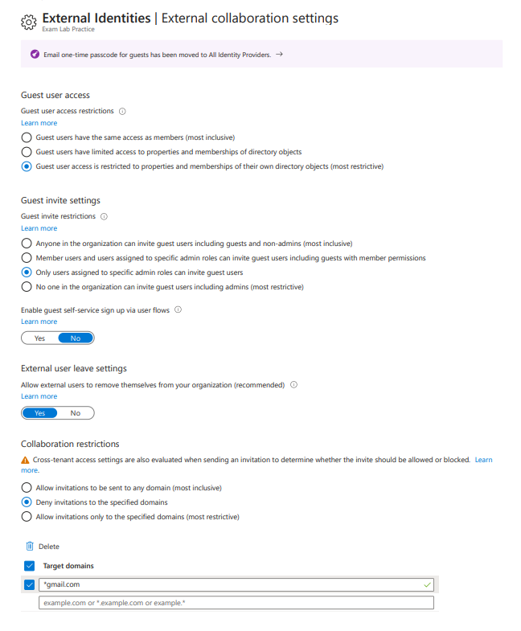

02 guest invite blocked denied domain

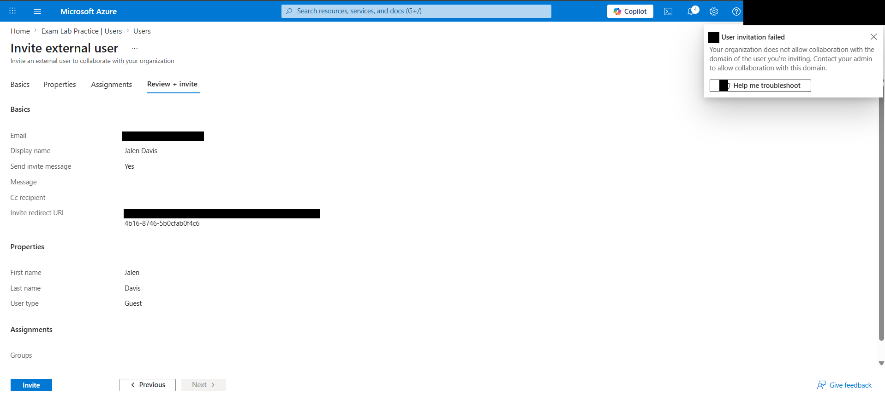

03 member invite blocked

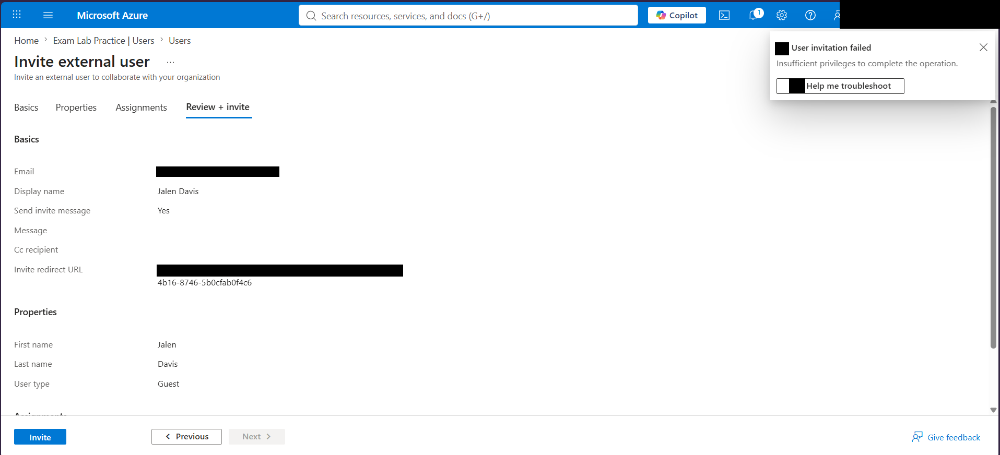

04 guest inviter invite success with property error

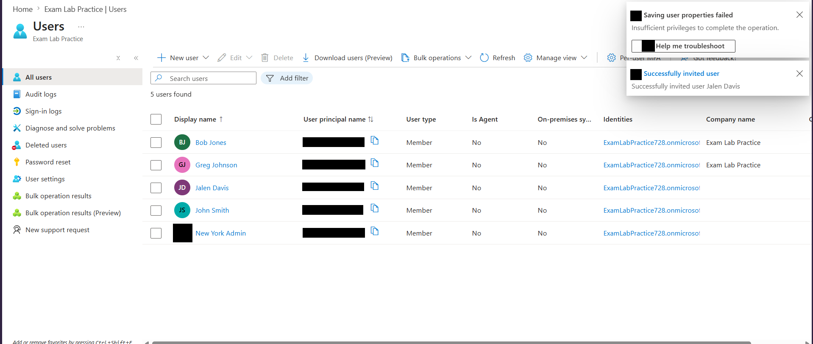

05 guest created ext upn pending

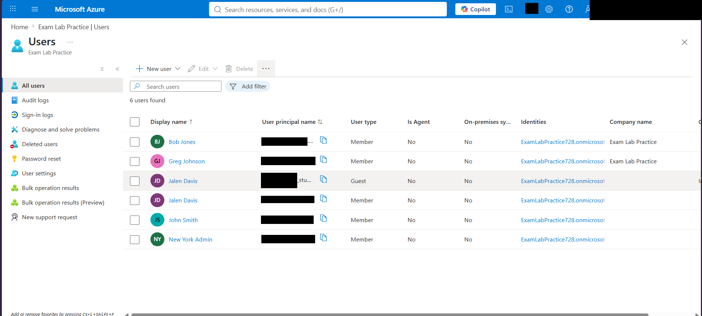

06 guest invitation accepted

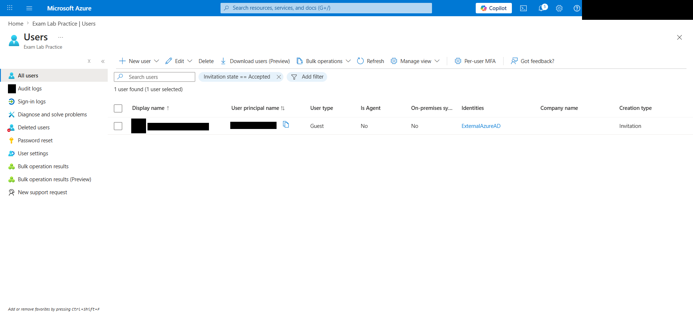

07 guest properties post redemption

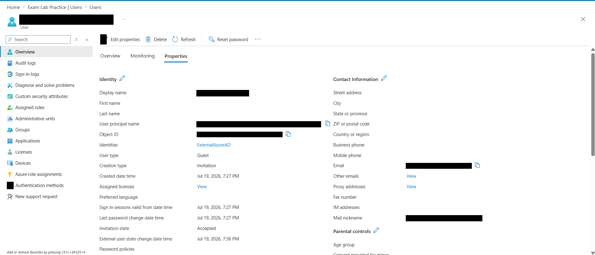

08 guest azure portal 401

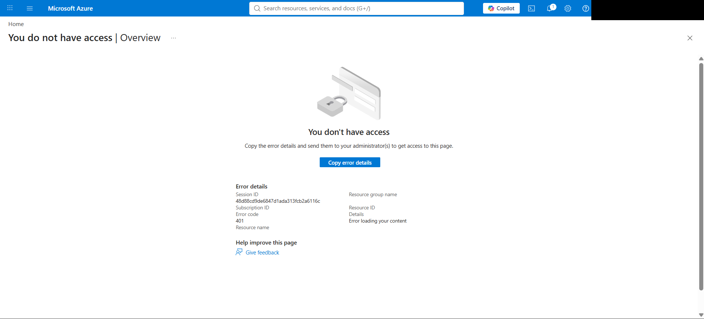

09 guest account disabled admin view

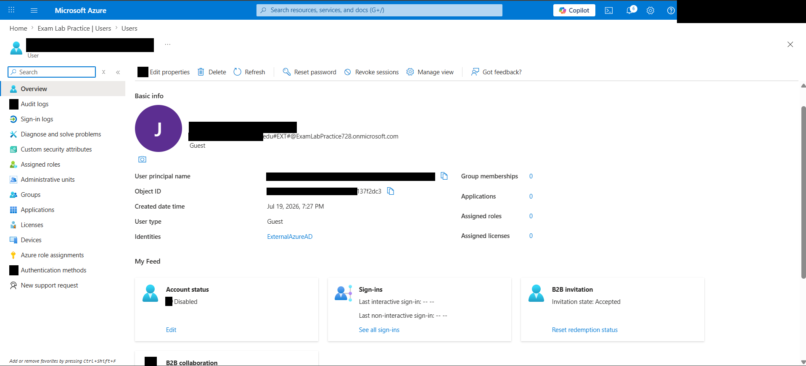

10 guest signin locked user view

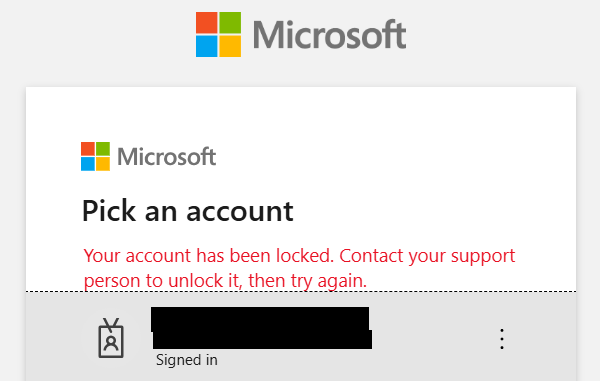

11 guest portal 401 after reenable

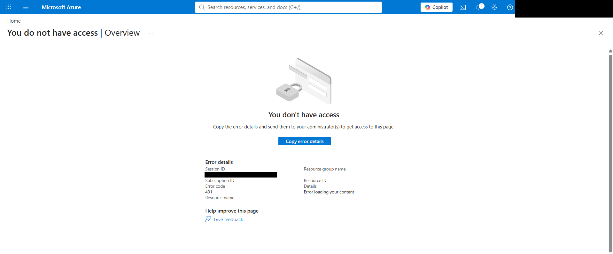

12 guest deleted toast

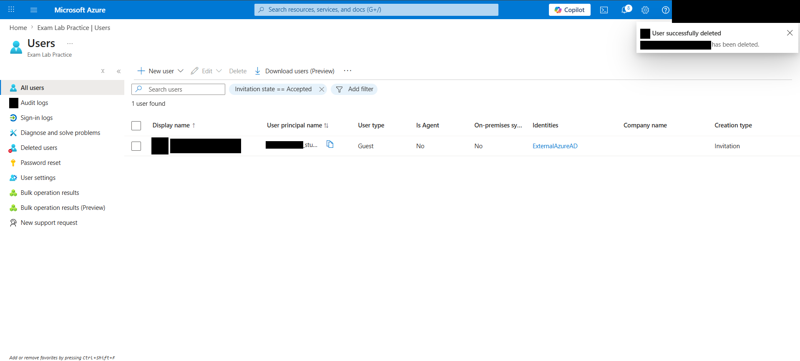

13 guest in deleted users 30day

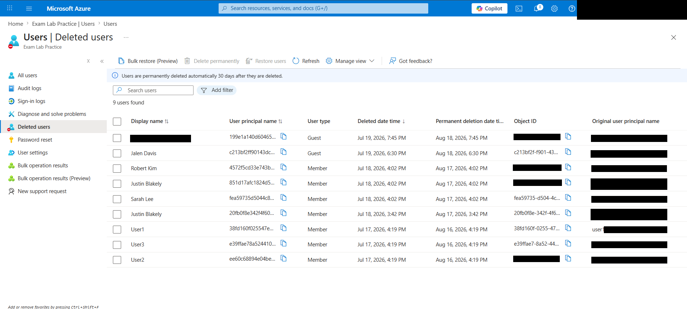

14 guest restored all users

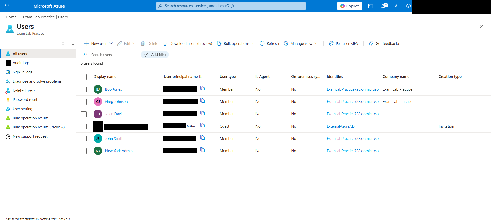

